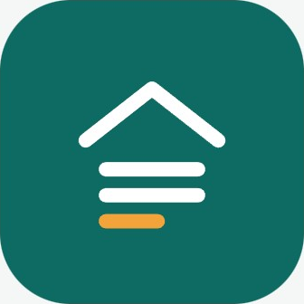

<p align="center">
  
</p>

<h1 align="center">Tenera Property Manager</h1>

<p align="center">
  <strong>Simple, Modern & Offline-First Property & Tenant Management for Landlords</strong>
</p>

<p align="center">
  <a href="https://github.com/Watot12345/Tenera/releases/latest"></a>
  <a href="https://github.com/Watot12345/Tenera/releases"></a>
  <a href="https://github.com/Watot12345/Tenera"></a>
  <a href="https://watot12345.github.io/Tenera/"></a>
  <a href="LICENSE"></a>
</p>

---

## 📖 Overview

**Tenera** is an offline-first mobile application built with Flutter, designed specifically for independent landlords, boarding house operators, and apartment managers. 

Unlike conventional cloud-only property apps that lock your data behind mandatory online accounts or monthly subscriptions, Tenera uses local **SQLite as its Single Source of Truth (SSOT)**. It gives you 100% functionality offline, with optional cloud synchronization to **Firebase Cloud Firestore** whenever you choose.

---

## 📲 Download & Installation

### Android APK Direct Download
Get the latest production release APK directly from GitHub:

👉 **[⬇️ Download Tenera APK (v1.0)](https://github.com/Watot12345/Tenera/releases/latest/download/app-release.apk)**

* 🌐 **Release Landing Site**: [https://watot12345.github.io/Tenera/](https://watot12345.github.io/Tenera/)
* 📦 **All GitHub Releases**: [https://github.com/Watot12345/Tenera/releases](https://github.com/Watot12345/Tenera/releases)
* 🛡️ **Privacy Policy**: [https://watot12345.github.io/Tenera/privacy-policy.html](https://watot12345.github.io/Tenera/privacy-policy.html)

---

## 🚀 Key Features

* **🏠 Concept C Roof Ledger Dashboard**
  * Dynamic, live monthly totals computed directly from SQLite.
  * Real-time metrics for Collected Rent, Expected Rent, Overdue tenants, and Vacancy.
  * High-contrast visual tokens (`#1D3557` Deep Navy, `#E9C46A` Warm Gold, `#2A9D8F` Emerald, `#E76F51` Terracotta).

* **⚡ Fast Payment Logging**
  * Live candidate search by tenant name, room number, or initials.
  * **Cash Photo Proof**: Capture or attach photos of paper cash handover directly to payment receipts.
  * **Digital Reference Tracking**: Log reference numbers for GCash, Maya, and Bank Transfer to avoid payment disputes.
  * Synchronous UI updates with atomic SQLite database transactions.

* **🏢 Room & Unit Status Matrix**
  * Visual room blocks color-coded by status (Occupied, Overdue, Vacant).
  * Long-press any room or tenant assignment to remove or vacate tenants.
  * Multi-property support with custom unit counts and monthly revenue metrics.

* **📴 100% Offline SQLite Single Source of Truth**
  * All properties, rooms, tenants, and payment records persist locally in `tenera.db`.
  * Zero required internet connectivity for everyday management.

* **🔄 Hybrid Cloud Sync (Firebase Firestore)**
  * Optional one-tap sync under **More ➔ Cloud & Database Sync**.
  * Partitioned by persistent, anonymous landlord device ID (`landlords/{landlord_id}/...`) without requiring an upfront forced login.

* **📲 Built-in In-App Updates**
  * Automatically checks the GitHub Releases API for newer releases.
  * Displays changelog notes and provides a one-tap APK download button.

---

## 🛠️ Tech Stack & Architecture

| Component | Technology |
| :--- | :--- |
| **Framework** | [Flutter](https://flutter.dev/) (SDK `>=3.7.0 <4.0.0`) |
| **Language** | [Dart](https://dart.dev/) |
| **Local Database** | [SQLite](https://www.sqlite.org/) via [`sqflite`](https://pub.dev/packages/sqflite) |
| **Cloud Sync** | [Google Cloud Firestore](https://firebase.google.com/products/firestore) via [`cloud_firestore`](https://pub.dev/packages/cloud_firestore) |
| **In-App Updater** | GitHub Releases API via [`http`](https://pub.dev/packages/http) & [`url_launcher`](https://pub.dev/packages/url_launcher) |
| **CI/CD** | [GitHub Actions](https://github.com/features/actions) for APK builds & GitHub Pages deployment |

---

## 💻 Developer Setup & Build Instructions

### Prerequisites
* Flutter SDK (3.29+ / 3.47+ stable)
* Java JDK 17
* Android SDK Platform 34+

### Clone & Run
```bash
# Clone repository
git clone https://github.com/Watot12345/Tenera.git
cd Tenera

# Install packages
flutter pub get

# Run analyzer
flutter analyze

# Execute test suite (15 unit & widget tests)
flutter test

# Run app in debug mode
flutter run
```

### Build Production APK
```bash
flutter build apk --release
```
The output APK is generated at `build/app/outputs/flutter-apk/app-release.apk`.

---

## 📄 License

This project is open source and available under the terms of the [MIT License](LICENSE).
